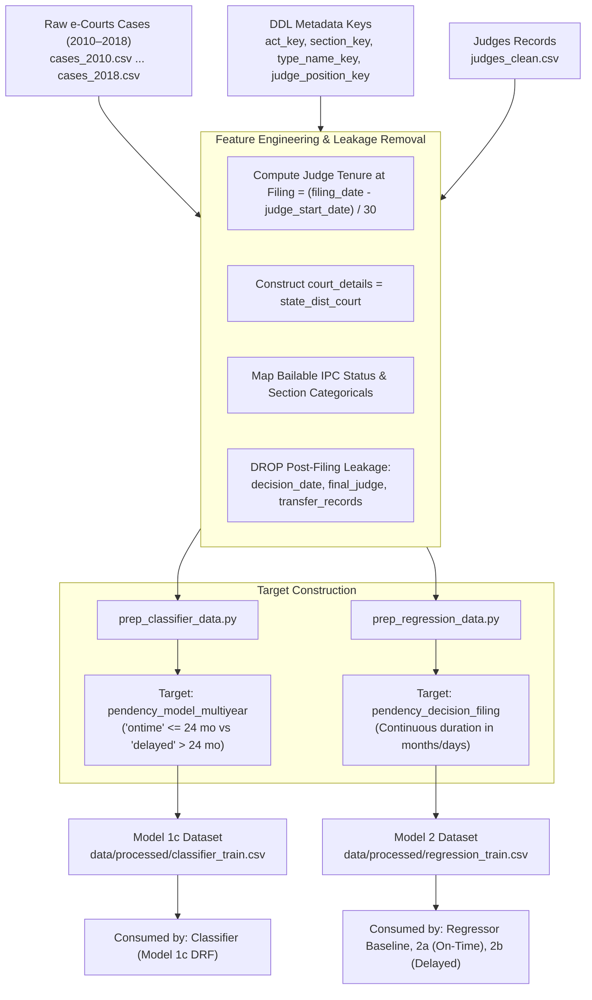

# Data Preparation Pipeline (`src/dataprep`)

This module houses the extract-transform-load (ETL) pipeline that processes raw Indian e-Courts case filings and lookup tables into clean, leak-free datasets for machine learning.

## Architecture & Data Flow

## Modules
1. **`prep_classifier_data.py`**:
   - Cleans raw cases, applies leak-free feature filters, maps binary multiyear delay label (`ontime` vs `delayed`), and writes processed classifier data.
2. **`prep_regression_data.py`**:
   - Retains continuous target `pendency_decision_filing` for duration regression across all criminal cases.
